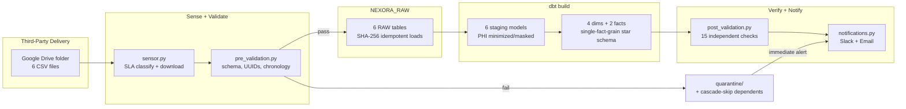

# 🏥❄️ CareSync: Quality-Gated ELT Platform for Weekly Clinic Reporting

[](https://www.python.org)
[](https://developers.google.com/drive)
[](https://www.snowflake.com)
[](https://www.getdbt.com)
[](https://github.com/features/actions)

> **TL;DR**
> 🏥❄️ Healthcare Analytics (CareSync): a quality-gated ELT platform that turns unreliable third-party weekly clinic file deliveries into a trusted Snowflake reporting database for clinic operations, provider workload planning, and payer reconciliation.
> **Stack:** Python 3.x, Google Drive API, GitHub Actions, Snowflake, dbt, Slack + Email alerts
> **Runtime:** ~2m 59s end-to-end pipeline, scheduled weekly on Sundays at 13:00 UTC with a 1-hour SLA window
> **Scale:** 6 CSVs, ~107K total rows across patients, encounters, conditions, providers, organizations, and payers; 38 dbt tests plus 15 post-validation checks on every run
> **Author:** Yomi Ismail, Data Engineer (Suffolk, UK)

---

## 📋 Table of Contents

- [About the Business](#about-the-business)
- [The Problem](#the-problem)
- [Stack Overview](#stack-overview)
- [Business Impact](#business-impact)
- [Architecture](#architecture)
- [Data Model and Schemas](#data-model-and-schemas)
- [Data Quality Story](#data-quality-story)
- [Engineering Decisions](#engineering-decisions)
- [Attribution](#attribution)
- [How to Reproduce](#how-to-reproduce)
- [Repository Structure](#repository-structure)
- [Honest Limits](#honest-limits)
- [About the Author](#about-the-author)
- [Connect](#connect)
- [License](#license)

---

## About the Business

Nexora's partner clinics don't deliver data directly. A third-party data aggregation agent consolidates each clinic's weekly export and drops six CSV files into a shared Google Drive folder on a contractual schedule. Clinic operations reviews, provider workload planning, and payer reconciliation all run off these weekly CareSync reports, so the timeliness and correctness of the files directly affects operational decisions across the clinic network.

Because a third party sits in the delivery chain, Nexora controls neither when the files arrive nor what condition they arrive in. Delivery times drift, export formats change when upstream clinic systems are upgraded, and files can arrive truncated or malformed.

The brief: build a platform that doesn't just move the files, but proves they're trustworthy before anyone reports off them - sensed against an SLA, validated before they touch the warehouse, transformed into a reporting-ready schema, and verified again after transformation, with every outcome communicated automatically. All data is synthetic, generated with [Synthea](https://synthetichealth.github.io/synthea/), an open-source synthetic patient generator, so the project carries no real patient information.

---

## The Problem

Six CSV files are expected every week:

| Dataset | File | Rows | Purpose |
|---|---|---|---|
| Organizations | `organizations.csv` | 1,127 | Healthcare facilities and locations |
| Payers | `payers.csv` | 10 | Insurance providers and financial metrics |
| Providers | `providers.csv` | 5,056 | Healthcare practitioners |
| Patients | `patients.csv` | 1,163 | Demographics and patient profiles |
| Encounters | `encounters.csv` | 61,459 | Patient care visits and appointments |
| Conditions | `conditions.csv` | 38,094 | Diagnoses and clinical history |

Files arrived inconsistently: sometimes late, sometimes with malformed values, sometimes early (which is its own problem - an early file can mean the upstream export ran against incomplete data). There was no automated validation, so bad data could reach downstream reports unnoticed. There was no record of when files actually arrived relative to the agreed schedule, and no SLA awareness or alerting. Before this pipeline, trusting a weekly drop meant manually checking it.

---

## Stack Overview

| Layer | Technology | Purpose |
|---|---|---|
| **Orchestration** | Python orchestrator + GitHub Actions | Sense → Validate → Load → Transform → Verify → Notify, in strict dependency order |
| **Source** | Google Drive API | Monitors the shared delivery folder for the 6 expected files, isolated behind a swappable interface |
| **Validation** | Python + pandas | Schema, mandatory fields, UUID format, allowed values, chronology, duplicates, row-count bounds |
| **Warehouse** | Snowflake | `NEXORA_RAW` → `NEXORA_STAGING` → `NEXORA_PROD`, key-pair (RSA/PKCS8) authentication |
| **Transformation** | dbt | 6 staging models + 4 dimensions + 2 facts, single-fact-grain star schema, 38 generic tests |
| **Scheduling** | GitHub Actions Schedule Trigger | Weekly, Sunday 13:00 UTC, 1-hour SLA window |
| **Notifications** | Slack Incoming Webhook + SMTP Email | SLA misses, validation failures, task errors, and a consolidated run summary |
| **Language** | Python 3.x, SQL | Sensor, validation, loading, orchestration, notifications; dbt models and tests |

---

## Business Impact

**Before this pipeline:**
- Manual check every week to confirm all 6 files had actually arrived
- No consistent schema enforcement, so a dropped or renamed column could reach the warehouse unnoticed
- No timestamped record of when files actually arrived relative to the agreed delivery window
- A single bad file could block or corrupt the whole weekly load, with no isolation
- No automated notification when a load failed or a file was late

**After this pipeline:**
- Arrival confidence: the sensor confirms all 6 files are present and classifies each as on-time, missing, too-early, or late against a 1-hour SLA window
- Schema enforcement: missing columns, wrong formats, or out-of-range values get a file quarantined while the rest of the run continues
- Immediate alerts: a quarantined file fires its own Slack/email alert the moment it's quarantined, not something stakeholders only discover buried in the end-of-run summary
- Skip-not-fail semantics: a quarantined file's downstream dependents are cascade-skipped rather than crashing the run, while unaffected files load normally
- Idempotent loads: a SHA-256 content hash means re-running a week's load never double-counts rows, no `TRUNCATE` required
- Analytics-ready output: dbt produces a PHI-minimized star schema with 38 built-in tests, independently re-verified by 15 post-validation checks
- Transparent flow: every stage is logged and timestamped, and the full outcome lands in Slack and email within seconds of the run finishing

---

## Architecture



The orchestrator runs six stages in strict dependency order: sense, validate, load, transform, verify, notify. A Google Drive sensor checks for the six expected files under a one-hour SLA and classifies each as on-time, missing, too-early, or late. A pandas pre-validation gate runs seven checks per file (schema, mandatory fields, UUID format, allowed values, chronology, duplicate IDs, row-count bounds) before anything touches the warehouse. Healthy files load into Snowflake's `NEXORA_RAW` layer with idempotent, content-hashed writes; a file that fails validation is quarantined, and the dependency graph (`organizations` → `patients` → `encounters` → `conditions`, etc.) cascade-skips anything downstream of it rather than failing the whole run. dbt transforms `NEXORA_RAW` into a staging layer, then a single-fact-grain star schema in `NEXORA_PROD`. A post-validation gate independently re-verifies the finished reporting layer - not just that dbt's own tests passed, but that the warehouse the business actually queries reconciles.

```
Sensor check + download          (~13s)
    │
    ▼
Pre-validate + load to RAW        (~85s, 6 files, strict dependency order)
    │
    ▼
dbt build                         (~31s; 12 models, 38 tests)
    │
    ▼
Post-validation                   (~43s; 15 checks)
    │
    ▼
Notify: Slack + Email summary
```

**End-to-end runtime:** ~2 minutes 59 seconds. **Schedule:** weekly, Sunday 13:00 UTC. **Cost:** free-tier eligible (GitHub Actions free minutes + Snowflake trial credit).

---

## Data Model and Schemas

**Three layers in Snowflake:**

- **`NEXORA_RAW`**: landing tables that mirror the validated CSV structure. Loaded via an idempotent SHA-256 content-hash check against a `FILE_HASH` column, so re-running a week never duplicates rows.
- **`NEXORA_STAGING`**: cleaned and standardized by dbt. This is where PHI is minimized - direct identifiers are excluded by omission rather than deleted downstream, and patient names are reduced to masked initials.
- **`NEXORA_PROD`**: the single-fact-grain star schema dbt builds on top of staging - the layer the business actually reports off.

**Mart layer table catalog:**

| Table | Type | Grain | Purpose |
|---|---|---|---|
| `dim_organizations` | Dimension | One row per facility | Healthcare facilities, revenue tier, utilization tier |
| `dim_payers` | Dimension | One row per payer | Insurance providers, coverage and size tier |
| `dim_providers` | Dimension | One row per practitioner | Providers, specialty category, caseload tier |
| `dim_patients` | Dimension | One row per patient | Masked initials, age (as-of death for deceased patients), age group, region |
| `fct_appointments` | Fact | One row per encounter | Visits with duration, coverage status, and time-of-day category |
| `fct_conditions` | Fact | One row per diagnosis | Diagnoses with active/resolved status and duration |

**Repository-relevant data paths:**

```
data/
├── landing/               # Sensor downloads land here before validation
└── landing/quarantine/    # Files that fail pre-validation, kept for review

sla_report.json            # Generated on each run - SLA classification per file
```

---

## Data Quality Story

Two independent validation layers catch different failure modes:

### Layer 1: Pre-validation before warehouse ingestion

Every file is assessed before any of its data leaves the landing zone: schema compliance, mandatory field presence, UUID format, allowed values, date chronology, duplicate primary keys, and row-count sanity bounds. A failure is specific - which file, which check, which row - and the file is physically moved into `data/landing/quarantine/` rather than silently dropped, firing its own Slack/email alert at the moment it happens rather than waiting for the end-of-run summary. Files that depend on a quarantined file are cascade-skipped through the dependency graph (`organizations` → `patients` → `encounters` → `conditions`), so one bad file can't produce an orphaned-FK load elsewhere. Unaffected files continue processing normally.

### Layer 2: Post-validation after transformation

Once dbt has built the reporting schema, `post_validation.py` independently re-verifies the finished product: 12 table-existence-and-row-count checks across staging and marts, plus 3 business reconciliation queries (staging-to-fact row parity, no future-dated encounters, patient counts matching across layers). This is deliberately separate from dbt's own 38 generic tests - passing dbt's tests proves the input was well-formed; post-validation proves the warehouse the business queries is actually correct.

### Why two gates instead of one

A single validation pass at ingestion only proves the input was well-formed - it says nothing about whether the finished warehouse reconciles after a full dbt rebuild. Splitting pre- and post-validation catches different failure classes: a malformed source row never reaches the warehouse, and a transformation bug that technically "builds" but produces the wrong output still gets caught before stakeholders see the notification.

---

## Engineering Decisions

**1. Quarantine + cascade-skip over fail-fast.**
A bad file could fail the whole run, or get silently dropped, or get quarantined with its dependents skipped. Chose quarantine with cascade-skip through the dependency graph: the bad file is physically moved to a quarantine folder and preserved for inspection, its own alert fires immediately, everything that depends on it is skipped rather than loaded with broken foreign keys, and everything unaffected still processes. Tradeoff: a bad week means a partial report. Gain: no silent data loss, no corrupted downstream tables, and stakeholders find out the moment it happens instead of when they next try to run an analysis.

**2. Idempotent loads via content hash, not `TRUNCATE`.**
Re-running a week's load could `TRUNCATE` and reload, or check before inserting. Chose a SHA-256 hash of filename plus file bytes, checked against a `FILE_HASH` column before insert. Tradeoff: slightly more bookkeeping per load. Gain: safe re-runs without a destructive `TRUNCATE`, and a verifiable record of exactly which file version loaded which rows.

**3. Key-pair auth over password for Snowflake.**
Snowflake supports both. Chose RSA/PKCS8 key-pair authentication over a password, loaded via the `cryptography` library. Tradeoff: more setup (key generation, public key registration in Snowflake). Gain: no password in CI secrets, rotation without touching application code, and a connection method that survives Snowflake's own password-deprecation direction.

**4. A genuinely swappable source interface.**
The Google Drive API calls in `sensor.py` sit behind two functions rather than being called inline throughout the pipeline. Tradeoff: a small layer of indirection for a project with only one source today. Gain: a future migration to SFTP or another delivery mechanism touches only that isolated boundary, not the SLA logic, the validation logic, or the orchestrator.

**5. PHI minimized at the staging boundary, not downstream.**
PHI could be filtered out at any layer, or redacted after the fact. Chose exclusion by omission in the staging models themselves - columns like SSN, driver's license, and full address are simply never selected, and patient names are masked to initials at the same boundary. Tradeoff: `NEXORA_RAW` still holds full source data for troubleshooting. Gain: the reporting layer never has PHI to leak in the first place, because it's structurally absent rather than filtered late.

**6. Prove it with pandas + GitHub Actions before Great Expectations + Airflow.**
The validation and orchestration logic could be built directly on production-grade tooling, or proven cheaply first. Chose to build and iterate with pandas checks and a GitHub Actions cron trigger, with the explicit intent to swap in Great Expectations suites and an Airflow DAG once the rules are proven. Tradeoff: the current implementation isn't production tooling yet. Gain: the pipeline shape (sense → validate → load → transform → verify → notify) is already correct, so the swap changes tooling, not architecture.

**7. Post-validation as a second, independent gate.**
dbt's own generic tests could be treated as sufficient. Added a separate `post_validation.py` pass that re-verifies table population and runs reconciliation queries independently of dbt's test framework. Tradeoff: some overlap with what dbt tests already check. Gain: a transformation bug that technically passes dbt's own tests but produces a warehouse the business can't trust still gets caught before the success notification goes out.

---

## Attribution

The synthetic patient data used in this project is generated with **[Synthea](https://synthetichealth.github.io/synthea/)**, an open-source synthetic patient population simulator originally developed at The MITRE Corporation. It produces realistic HL7-shaped healthcare records - patients, encounters, conditions, providers, payers, and organizations - with no real patient information involved anywhere in the pipeline.

The pipeline architecture, data quality design, orchestration logic, dbt modeling, and engineering decisions are original work by Yomi Ismail.

---

## How to Reproduce

Prerequisites:

- Python 3.x
- A Snowflake account (trial is sufficient)
- A Google Cloud service account with read access to the delivery Drive folder
- A GitHub repository with Actions enabled

Setup steps:

1. **Fork the repository.**
2. **Install dependencies.** `pip install -r requirements.txt`.
3. **Google Drive access.** Create a Google Cloud service account with Drive API read scope, share the delivery folder with its email address, and set `FOLDER_ID` to that folder's ID. Provide credentials either as `GOOGLE_DRIVE_SERVICE_ACCOUNT` (the service account JSON as an env var) or as a local `service-account-key.json`.
4. **Snowflake key-pair auth.** Generate an RSA key pair, register the public key on your Snowflake user, and point `RSA_PRIVATE_KEY` at the private key. Set `SNOWFLAKE_ACCOUNT`, `SNOWFLAKE_USER`, `SNOWFLAKE_DATABASE`, `SNOWFLAKE_WAREHOUSE`, `SNOWFLAKE_ROLE`.
5. **Snowflake schema setup.** Create the `NEXORA_RAW`, `NEXORA_STAGING`, and `NEXORA_PROD` databases/schemas referenced in the dbt model configs.
6. **dbt profile.** Configure `.dbt/profiles.yml` with your Snowflake target, then `dbt deps` and `dbt build` to test locally.
7. **Notifications.** Set `SLACK_WEBHOOK_URL` for Slack alerts, and `SMTP_SERVER` / `SMTP_PORT` / `SMTP_USER` / `SMTP_PASSWORD` / `NOTIFICATION_EMAIL` for email alerts.
8. **GitHub Secrets.** Store every environment variable above as an encrypted repository secret.
9. **Enable the workflow.** The weekly schedule (`.github/workflows/pipeline.yml`, Sundays at 13:00 UTC) activates on merge to `main`; use the Run workflow button for manual tests.

---

## Repository Structure

```
caresync_project/
├── python/
│   ├── config.py                  # Env config, expected schemas, SLA schedule
│   ├── sensor.py                  # Google Drive polling + SLA classification
│   ├── pre_validation.py          # Per-file validation rules
│   ├── snowflake_loader.py        # RAW layer ingestion, key-pair auth, content-hash dedup
│   ├── dbt_runner.py              # dbt build orchestration
│   ├── post_validation.py         # Independent warehouse reconciliation checks
│   ├── notifications.py           # Slack + email delivery
│   ├── orchestrator.py            # Stage control, dependency order, cascade-skip
│   ├── logger.py                  # Structured logging utilities
│   ├── data_dictionary.ipynb      # Source schema documentation
│   └── exploration.ipynb          # Ad hoc data exploration
├── models/
│   ├── _sources.yml                # RAW source declarations
│   ├── staging/
│   │   └── hl7/
│   │       ├── stg_hl7__*.sql      # 6 staging models, PHI minimized here
│   │       └── _tests.yml          # Staging-layer generic tests
│   └── marts/
│       ├── dim_*.sql               # 4 dimensions
│       ├── fct_*.sql               # 2 facts
│       └── _tests.yml              # Marts-layer PK/FK generic tests
├── tests/
│   ├── fct_conditions_unique_grain.sql   # Singular test: conditions grain has no single-column PK
│   └── test_sensor_credentials.py
├── .github/
│   └── workflows/
│       └── pipeline.yml            # Weekly schedule + manual dispatch
├── .dbt/
│   └── profiles.yml                # dbt Snowflake connection profile
├── dbt_project.yml
├── packages.yml                    # dbt-labs/codegen
├── requirements.txt                # Python dependencies
└── README.md                       # This file
```

---

## Honest Limits

**1. No HIPAA compliance.** PHI is minimized by omission at the staging boundary and names are masked to initials, but there's no column-level encryption, no query audit logging, and no formal access control layer. That's PHI-conscious design, not HIPAA compliance - worth naming as scope, not oversight, especially since the data is synthetic Synthea output anyway.

**2. Stage 1 only - no Great Expectations or Airflow yet.** Validation is hand-written pandas checks and orchestration is a GitHub Actions cron trigger. Both are deliberately designed to be swapped for Great Expectations and Airflow without reshaping the pipeline, but that swap hasn't happened yet.

**3. No unit tests on the Python layer.** Data quality is enforced at runtime by pre-validation and post-validation, but the sensor, loader, and orchestrator code itself has no pytest coverage. There's no CI-time check that a refactor of the cascade-skip logic or the SHA-256 dedup check still behaves correctly against fixtures.

**4. No SCD Type 2 on `dim_patients`.** If a patient's region, county, or payer coverage changes between weekly loads, the previous value is overwritten. Real reporting often needs history (coverage as of the encounter date, not as of today). Adding SCD Type 2 would need effective-from/effective-to columns and updated load logic.

**5. No backfill tooling.** The pipeline expects one file set per week and quarantines what fails pre-validation. If a file is missed or quarantined, there's no automated reprocessing job - re-running means manually re-uploading to the source folder for the next scheduled run to pick up.

**6. No `.env.example` or LICENSE file yet.** Required environment variables are documented in [How to Reproduce](#how-to-reproduce), but there's no template file to copy from. No license is currently attached to the repository either - see [License](#license).

---

## About the Author

**Yomi Ismail** builds end-to-end data pipelines across cloud and on-premise stacks. This project grew from a need to standardize unreliable third-party healthcare data delivery - moving from the simple question of "did the files arrive?" to a repeatable, quality-gated, and auditable data platform.

**Related work in the same portfolio:**

- **[National Hospital](https://github.com/yoismail/national_hospital_azure_dw)**: Azure ELT pipeline using ADF orchestration, Databricks transformation, ADLS Gen2 storage, and Azure SQL Data Warehouse
- **[Nova Retail](https://github.com/yoismail/nova_retail_case_study)**: Containerised on-premise data platform with Docker Compose, Airflow-orchestrated PySpark medallion pipeline, and PostgreSQL Gold layer
- **[World Football Insights](https://github.com/yoismail/worldcup_football_intelligence)**: Cloud-native serverless ELT on GCP with Cloud Composer, Dataproc Serverless, GCS lakehouse, and BigQuery warehouse
- **[FibbieBanks](https://github.com/yoismail/fibbie_banks)**: 1M-row PySpark ETL with deterministic SHA-256 surrogate keys and validated PostgreSQL star schema

---

## Connect

- 🌐 **Portfolio:** [yoismail.github.io/portfolio](https://yoismail.github.io/portfolio)
- 📄 **Case study:** [yoismail.github.io/portfolio/caresync.html](https://yoismail.github.io/portfolio/caresync.html)
- 💼 **LinkedIn:** [linkedin.com/in/yomi-ismail](https://www.linkedin.com/in/yomi-ismail)
- 📧 **Email:** ismailyomi@gmail.com

---

## License

No license file is currently included in this repository, so all rights are reserved by default until one is added.

---

*Built in Suffolk, England.*
